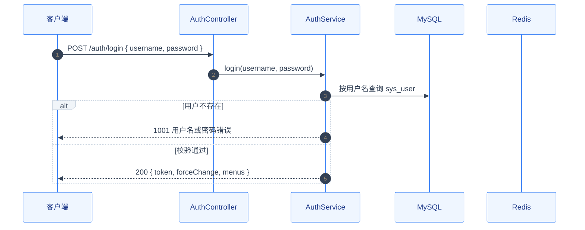
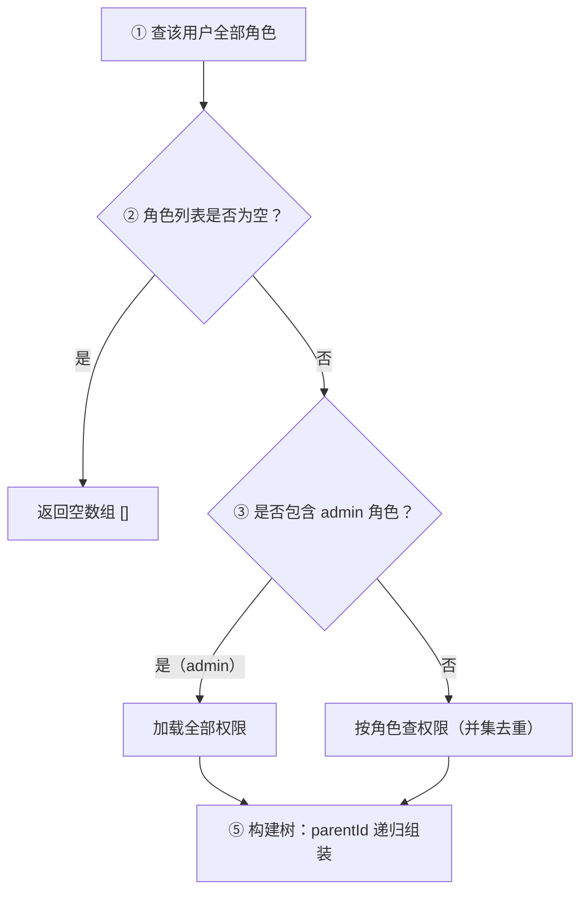

# 参考：中间产物 MD 样式 —— 图表示例与澄清卡片示例

> 用途：`templates/通用-中间产物-MD样式规范.md` 的**示例部分**，从主文件移出以降低「每次生成产物前必读」的体量。
> **按需阅读**：① 技术方案要画 mermaid 时序图/流程图、或要写调用骨架时读第一节；
> ② 要生成 1.3 澄清问题清单 / 0.6 待澄清卡片、不确定卡片排版时读第二节。
> 主文件里的**规则与红线仍然有效**，示例只示范形态，不覆盖规则。

---

## 一、技术方案专属样式（调用骨架 + mermaid 图）

### 2.1 调用骨架（分层调用）——核心逻辑必配

核心逻辑用 **text 代码块**展示「入口 → Service → Mapper」分层调用，函数体用中文编号步骤，**禁止写实现代码**。

```text
# ============ Controller（纯转发：无业务逻辑、不 try/catch）============
AuthController
├─ login(LoginDTO) → Result<LoginVO>                     # 登录 → AuthService.login(dto)
├─ logout() → Result<Void>                               # 登出 → AuthService.logout()
└─ changePassword(ChangePasswordDTO) → Result<Void>      # 自助改密 → AuthService.changePassword(dto)

# ============ Service（业务编排）============
AuthServiceImpl
├─ login(LoginDTO) → LoginVO
│   # 1. 查用户 → sysUserMapper.selectByUsername(username)；不存在或密码不匹配 → 500「用户名或密码错误」（业务异常统一 500，靠 message 区分）
│   # 2. 校验用户状态；已禁用 → 500「账号已被禁用」
│   # 3. 签发 JWT → jwtTokenProvider.generate(userId, username)
│   # 4. 组装返回 LoginVO
└─ changePassword(ChangePasswordDTO) → void
    # 1. 取当前 userId（防 IDOR）
    # 2. 查用户 → sysUserMapper.selectById(userId)；校验旧密码；不匹配 → 500「原密码错误」
    # 3. 新密码加密 → sysUserMapper.updateById(user)，下次登录生效

# ============ Mapper（数据访问，函数下附对应 SQL）============
SysUserMapper
├─ selectByUsername(String username) → SysUser           # 登录：按用户名查用户
│   └─ SQL: SELECT * FROM sys_user WHERE username = #{username} AND deleted = 0
└─ updateById(SysUser user) → int                        # 改密：更新密码
    └─ SQL: UPDATE sys_user SET password = #{password}, update_time = NOW()
            WHERE id = #{id} AND deleted = 0
```

**调用骨架规则**：

- 用 `# ============ 层名（职责）============` 分块：入口层（Controller/Listener/Job）→ Service → Mapper
- 函数行：`├─ 方法签名 → 返回类型`，行尾注释写**用途 + `→` 调用标注**（调用了下层的哪个方法）
- **简单函数**：行尾注释说明做什么即可；**复杂函数**：函数体用 `│   # 1.` 中文编号步骤描述，调用关系用 `→ service.xxx()` / `→ mapper.xxx()` 标注
- **Mapper 函数**：函数下缩进 `└─ SQL: ...` 内联对应 SQL（与"数据模型与 SQL"章节一一对应）
- 纯中文业务描述，禁止写语句级实现代码；图后不需要另附"处理步骤"（骨架已含步骤）

### 2.2 时序图（sequenceDiagram）——可选增强（复杂跨系统交互）

> [!NOTE] 与调用骨架的关系
> 调用骨架是核心逻辑的**必配主体**（分层 + 中文步骤已覆盖）；mermaid 时序图仅在**复杂跨系统交互**（多服务协作 / 外部依赖 / 时序敏感场景）时作为增强补充，不强制。若使用，配色走统一主题变量，图后步骤见调用骨架，不重复写。



**时序图规则**：
- 第一行 init 主题变量**逐字使用上方配置**（统一配色，禁止自创颜色）
- `autonumber` 自动编号；参与者别名用**中文业务名**（`C as 客户端`）
- 用 `alt / else / end` 表达分支；`rect` 表达并行区（如需）
- 关键消息写清路径与入参；响应消息标注状态码与关键字段
- 图仅作增强，中文步骤以调用骨架为准

### 2.3 流程图（flowchart）——可选增强（复杂决策 / 状态流转）

> 复杂决策/状态流转可用流程图增强；简单流程不必画图（调用骨架已覆盖步骤）。



**流程图规则**：
- 第一行 init 主题变量**逐字使用上方配置**
- 节点文字带 `① ② ③` 序号 + 中文描述，与「处理步骤」编号对应
- 决策节点（菱形）用 `{"..."}`；分支标签写明判定条件（`|"是"|`）
- 复杂分支图放「业务规则」小节；简单流程不必画图（避免过度）

### 2.4 mermaid 渲染注意

- **渲染器要求**：GitHub / GitLab / Obsidian / VSCode 均原生支持 mermaid，直接写代码块即可
- **调用骨架是主体**：mermaid 图是可选增强；即使目标平台不支持 mermaid 渲染，方案也完整可读（中文步骤全在调用骨架里）
- 图内禁止超长句子（一行 ≤ 40 字符），长描述放调用骨架步骤

---


---

## 二、澄清问题卡片示例（1.3 / 0.6）

> 卡片字段与勾选规则见主文件「1.6 澄清问题卡片」，下列为排版示例。

```markdown
### #2 🔴 amount 是用户录入还是系统计算

**涉及功能项**：#1 订单创建　|　**类型/来源**：模式库 P1（计算vs录入）· 阻塞

**一句话**：表1 有 amount 字段，页面上又有"优惠券""运费"输入框——金额到底谁算？

**背景**：

- §4.1 表1：`amount`｜decimal(12,2)｜是｜订单金额
- §2.1 未说明谁来算

**要确认**：谁算、公式是什么？

**结论**：

- **【AI 推荐】系统计算**：`amount = Σ(单价 × 数量) − 优惠 + 运费` —— 理由：…
- [ ] 用户手工录入，只做范围校验
- [ ] 其它（请手写）：

处理人 / 日期：
```
